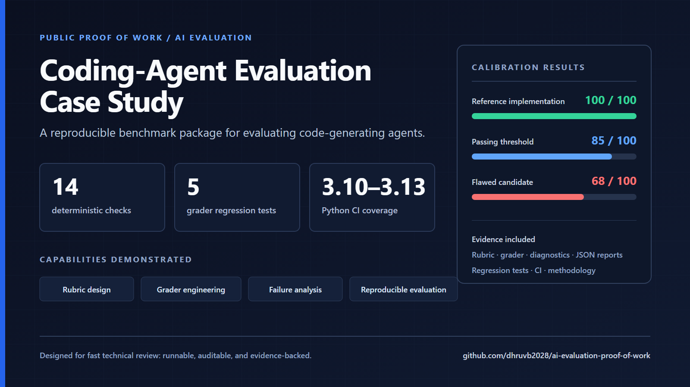
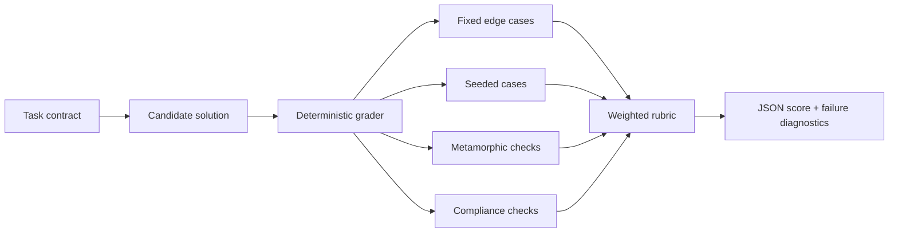

# Coding-Agent Evaluation Case Study



[](https://github.com/dhruvb2028/ai-evaluation-proof-of-work/actions/workflows/ci.yml)
[](https://www.python.org/)
[](LICENSE)

An auditable, sanitized example of how I turn a coding task into a fair and reproducible AI-agent benchmark: specification, reference implementation, weighted rubric, deterministic grader, anti-shortcut checks, failure diagnostics and grader regression tests.

> **Portfolio scope:** this repository contains no proprietary tasks, hidden tests, client data or confidential evaluation material. It demonstrates the evaluation methodology and engineering patterns I use.

## Results at a glance

| Candidate | Score | Decision | What the grader reveals |
| --- | ---: | --- | --- |
| Reference implementation | **100/100** | Pass | Satisfies correctness, validation, behavioral and compliance requirements |
| Intentionally flawed implementation | **68/100** | Fail | Mutates inputs and fails important validation requirements |

Passing threshold: **85/100**. The 32-point separation shows that the benchmark distinguishes a complete implementation from a plausible-looking but behaviorally incomplete one. Reports are generated from the grader—not handwritten—and committed in [`results/`](results/).

## Two-minute review path

1. Read the [`benchmark specification`](benchmark_spec.md) to see the task contract and edge cases.
2. Inspect the machine-readable [`rubric`](rubric.json) and its weighted evaluation dimensions.
3. Review the deterministic [`grader`](grader.py), especially the seeded and metamorphic checks.
4. Compare the generated [`reference report`](results/reference_report.json) with the [`flawed report`](results/flawed_report.json).
5. Read the short [`case study`](docs/case-study.md) for design decisions, failure analysis and limitations.

## What this demonstrates

| Evaluation capability | Evidence |
| --- | --- |
| Task authoring | A precise interface, constraints, error semantics and acceptance criteria in `benchmark_spec.md` |
| Rubric design | A 100-point rubric separating core correctness, robustness and behavioral compliance |
| Grader engineering | Check-level diagnostics, deterministic seeds, structured JSON output and section scores |
| Hidden-test strategy | Fixed edge cases plus seeded cases that candidates cannot satisfy with a small lookup table |
| Anti-shortcut design | Translation-invariance and input-immutability checks test behavior, not just examples |
| Failure analysis | The flawed candidate receives a diagnostic failure list instead of an opaque score |
| Quality assurance | Regression tests verify pass/fail calibration and score consistency with the rubric |
| Reproducibility | Standard-library-only execution, fixed seeds and CI on multiple Python versions |

## Evaluation architecture



## Benchmark under test

The sample asks a coding agent to implement a robust trimmed mean. The surface area is intentionally small so a reviewer can audit the full evaluation quickly. The evaluation challenge is not the formula itself; it is enforcing the complete behavioral contract:

- correct symmetric trimming across fixed and seeded inputs;
- generator support, duplicates, negative values and extreme values;
- explicit rejection of empty, malformed, boolean and non-finite inputs;
- input immutability and deterministic float output;
- translation invariance as a metamorphic property;
- standard-library-only implementation.

## Run locally

```bash
python grader.py reference_solution.py
python grader.py sample_buggy_solution.py
python -m unittest discover -s tests -v
python scripts/generate_reports.py
```

No third-party Python packages are required.

## Repository map

```text
assets/recruiter-evaluation-case-study.png  Recruiter-facing project cover
benchmark_spec.md                         Human-readable task contract
rubric.json                               Machine-readable 100-point rubric
grader.py                                 Deterministic evaluation harness
reference_solution.py                     Known-good implementation
sample_buggy_solution.py                  Plausible but incomplete candidate
results/                                  Generated, reviewable score reports
docs/case-study.md                         Design decisions and failure analysis
docs/evaluation-methodology.md             Reusable benchmark-quality checklist
scripts/generate_reports.py                Rebuilds committed evidence
tests/test_grader.py                       Grader and calibration regression tests
```

## Recruiter relevance

This case study provides concrete evidence for roles involving **AI evaluation, LLM evaluation, coding-agent benchmarking, AI training data, rubric design, grader design, failure analysis, dataset quality and Python testing**. It is designed to be inspected, executed and challenged—not merely described.

## Security boundary

The demo grader imports trusted local examples for simplicity. Production execution of untrusted model-generated code must use a hardened sandbox with network isolation, filesystem restrictions, resource limits and timeouts. See [`SECURITY.md`](SECURITY.md).

